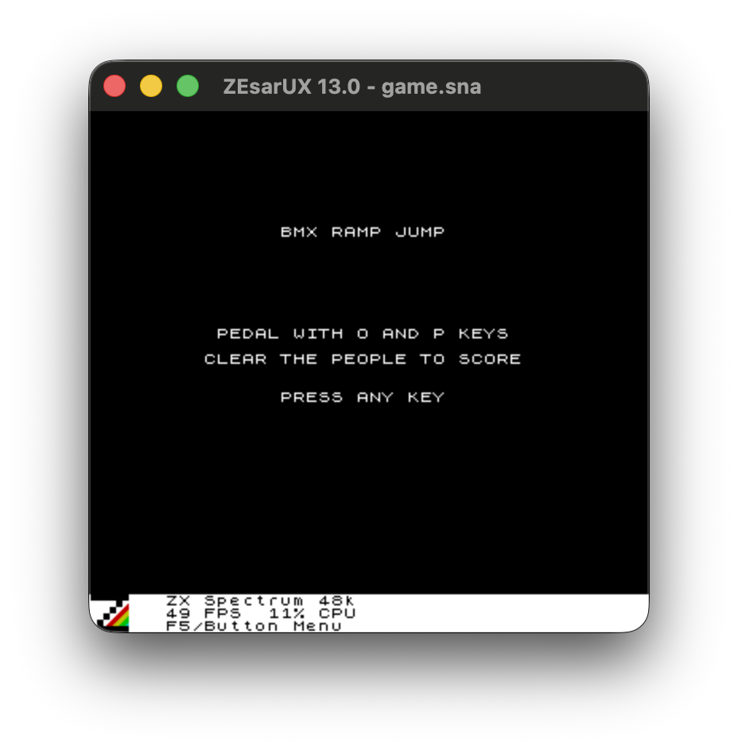
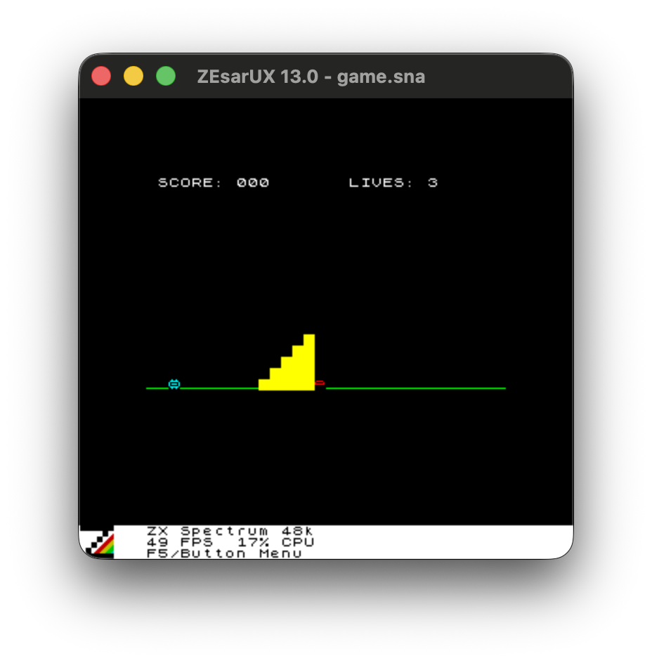

# zxspectrum-bmx-jump

A spec driven Claude code project to build a ZX Spectrum game. The SPEC.md file captured
my requirements, I then asked Claude Sonnet 5 to build the game based on the spec.

While others are busily one-shotting GTA VI clones, I ended up with this:




Without specifying that the game should be in ZX Spectrum BASIC, Claude
wrote scripts to build the game, and wrote it in Z80 assembly!

The source is built eith with sjasmplus and tested headlessly against
ZEsarUX over its ZRCP
remote-control protocol.

## Requirements

| Tool | Used for | Get it from |
| --- | --- | --- |
| [ZEsarUX](https://github.com/chernandezba/zesarux) | ZX Spectrum emulator the game is tested against | Download the `.dmg` from the [releases page](https://github.com/chernandezba/zesarux/releases) — Homebrew's cask is currently disabled because it fails Apple's Gatekeeper check. Open the `.dmg` and drag `zesarux.app` into `/Applications`; this project's scripts expect it at `/Applications/zesarux.app`. |
| [sjasmplus](https://github.com/z00m128/sjasmplus) v1.24.0 | Z80 assembler that builds `src/main.asm` | Not a separate download — `./scripts/setup.sh` clones and builds it from source automatically. |
| Git | Clones sjasmplus for the build above | Bundled with Xcode Command Line Tools (`xcode-select --install`), or https://git-scm.com/downloads |
| CMake | Builds sjasmplus | `brew install cmake`, or https://cmake.org/download/ |
| A C++ toolchain | Builds sjasmplus | Xcode Command Line Tools: `xcode-select --install` |
| Python 3 | Runs `scripts/zx.py`, the ZRCP test client | Preinstalled on macOS, or https://www.python.org/downloads/ |
| [Pillow](https://pypi.org/project/pillow/) | Converts ZEsarUX's BMP screenshots to PNG | Not a separate download — `./scripts/setup.sh` installs it into a venv automatically. |

## Setup

1. Install ZEsarUX, Git, CMake, a C++ toolchain, and Python 3 per the table
   above.
2. Run `./scripts/setup.sh` — builds sjasmplus from source into
   `../tools/sjasmplus/build/` and creates a `../.venv` with Pillow. Both
   live one directory above this repo, not inside it, so a full sjasmplus
   git checkout doesn't end up nested inside this project's git repo.

## Usage

```
./scripts/build.sh   # assemble src/main.asm -> build/game.sna
./scripts/test.sh    # build, load into ZEsarUX, save build/screenshot.png
```

`scripts/zx.py` is the ZRCP client used by these scripts (`start`, `stop`,
`load <snapshot>`, `screenshot <out.png>`, `registers`, `keys <ascii...>`,
`cmd <raw ZRCP command>`) — useful directly when iterating.

## Notes on the ZRCP setup

- ZEsarUX is launched with `--vo null --ao null`: the default `cocoa` video
  driver ties CPU emulation to the real display's render/vsync loop, which
  stalls the whole Z80 core if the screen is asleep or the app isn't in the
  foreground. Headless drivers keep the core running independent of any
  window server, which is what makes unattended scripted testing reliable.
- `snapshot-load "<absolute path>"` silently fails over ZRCP. The working
  pattern is `cd "<dir>"` followed by `smartload <relative filename>`.
- A fresh ZEsarUX launch starts with a menu open, which blocks entering
  cpu-step mode (and therefore loading); `close-all-menus` must be sent
  first.
- After `smartload`/`snapshot-load` of a `.sna`, reads from ROM (0-16383,
  e.g. the character font at 15616) come back as all zeros in this
  ZEsarUX build, even though a freshly-booted (unloaded) instance reads
  ROM correctly. Cause unconfirmed. Workaround: don't rely on the ROM at
  runtime — `src/font.bin` is a build-time copy of the ROM's character
  set (extracted once from `48.rom`), `INCBIN`-ed into the program so
  text rendering doesn't touch ROM at all.
- `zx.py start` passes `--no-saveconf-on-exit`. Without it, ZEsarUX
  persists whatever `--vo`/`--ao` were active into the user's global
  `~/.zesaruxrc` when it exits — which a normal GUI launch from
  Applications also reads — so a headless test run could otherwise leave
  every future double-clicked launch starting with video/audio disabled
  (a blank window).
